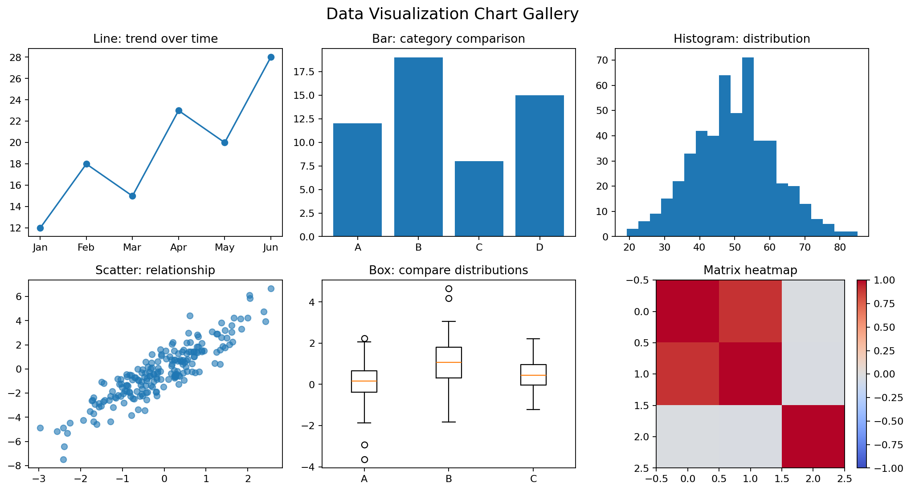
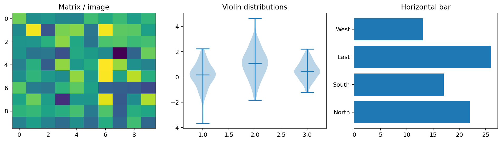

# Rendered Chart Examples

The images below are generated from synthetic example data. They demonstrate chart forms, not real-world findings.

## Core chart gallery

## Additional chart forms

For each chart, reproduce the figure using the code in `02-chart-catalog.md`, then change the data and labels.
